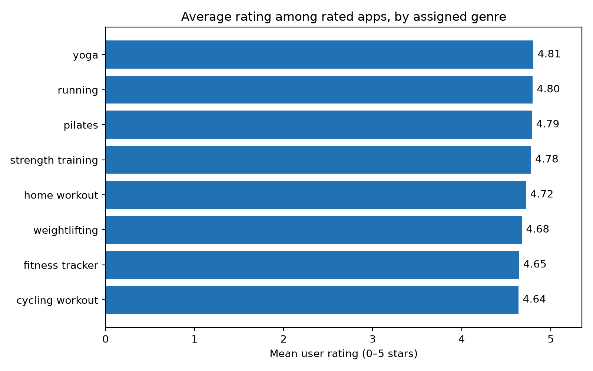
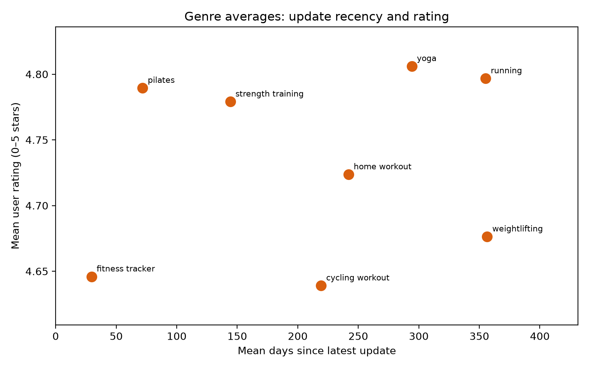
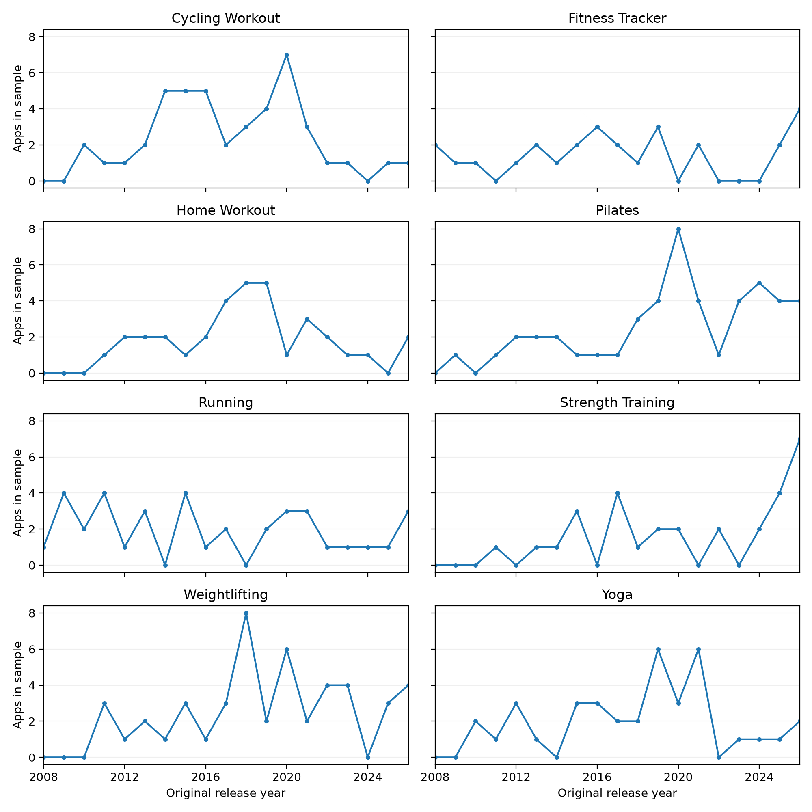
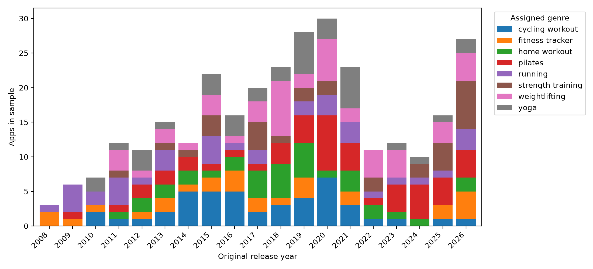

## Introduction

The health and wellness space has grown substantially over the last decade. The increased access to technology has only helped the commercialism found in the fitness market. This blog explores how different fitness app genres rate in the Apple app store. With access to release dates we will also explore any trends to see how the fitness app space has grown over time, and specifically if a genre in particular is becoming more popular.


The [project repository](https://github.com/micah2thepew/fitness-app-analysis) contains the Python collection, cleaning, and analysis scripts.

## How I collected the apps

I used [Apple's Search API](https://developer.apple.com/library/archive/documentation/AudioVideo/Conceptual/iTuneSearchAPI/SearchExamples.html) to gather app metadata. The collection script has five steps, each shown below. Together they request up to 50 U.S. apps for each of eight search phrases, keep results in Apple's *Health & Fitness* category, and use app IDs to avoid duplicate rows.

The data collection script left a 3 second interval between each request to ensure that the API was not overloaded. No personal information from any of the users was collected or displayed.

### Set up the searches

First, define the eight search phrases and record when the collection starts. The dictionary will hold one record per app ID.

```{python}
#| eval: false
from datetime import datetime, timezone
from pathlib import Path
import time

import pandas as pd
import requests


SEARCH_TERMS = [
    "running",
    "weightlifting",
    "strength training",
    "yoga",
    "pilates",
    "cycling workout",
    "home workout",
    "fitness tracker",
]

apps_by_id = {}
collected_at = datetime.now(timezone.utc).isoformat()
```

### Request one set of results

This function sends a GET request for one search phrase. The parameters choose U.S. software results and request up to 50 apps; `raise_for_status()` stops on an HTTP error.

```{python}
#| eval: false
def fetch_results(term):
    response = requests.get(
        "https://itunes.apple.com/search",
        params={
            "term": term,
            "country": "us",
            "entity": "software",
            "limit": 50,
        },
        timeout=30,
    )
    response.raise_for_status()
    return response.json()["results"]
```

### Select the fields

Each API result contains many fields. This helper keeps the app ID, name, developer, ratings, price, and dates needed for the analysis.

```{python}
#| eval: false
def make_record(app, collected_at):
    return {
        "app_id": app["trackId"],
        "name": app.get("trackName"),
        "developer": app.get("artistName"),
        "genre": app.get("primaryGenreName"),
        "rating": app.get("averageUserRating"),
        "rating_count": app.get("userRatingCount"),
        "upfront_price": app.get("price"),
        "release_date": app.get("releaseDate"),
        "latest_update": app.get("currentVersionReleaseDate"),
        "collected_at": collected_at,
        "search_terms": set(),
    }
```

### Combine results without duplicate apps

The outer loop repeats the search for each phrase. The inner loop keeps Health & Fitness apps and records every phrase that found an app. A three-second wait spaces out the requests.

```{python}
#| eval: false
for term in SEARCH_TERMS:
    results = fetch_results(term)

    for app in results:
        # Keep apps in Apple's Health & Fitness genre.
        if app.get("primaryGenreName") != "Health & Fitness":
            continue

        app_id = app.get("trackId")
        if app_id is None:
            continue

        # An app can appear in more than one search.
        if app_id not in apps_by_id:
            apps_by_id[app_id] = make_record(app, collected_at)

        apps_by_id[app_id]["search_terms"].add(term)

    print(f"{term}: {len(results)} results")
    time.sleep(3)  # Space out requests.
```

### Save the first CSV

Sets are useful for collecting unique search terms, but CSV cells need text. The final block joins those terms, builds a pandas table, and writes the initial dataset.

```{python}
#| eval: false
# Convert the sets of search terms into text that fits in a CSV file.
rows = []
for app in apps_by_id.values():
    app["search_terms"] = ", ".join(sorted(app["search_terms"]))
    rows.append(app)

df = pd.DataFrame(rows)

Path("data").mkdir(exist_ok=True)
df.to_csv("data/fitness_apps_initial.csv", index=False)

print(f"\nUnique Health & Fitness apps: {len(df)}")
print(f"Columns: {list(df.columns)}")
print(df[["name", "rating", "rating_count", "search_terms"]].head())
```

## Turning search results into analysis-ready features

After removing repeated app IDs, **42 apps matched more than one search phrase**. To make one genre label per app for the charts, I used a fixed priority order. When an app matched *fitness tracker* and another phrase, I dropped *fitness tracker* as a possible label; when multiple phrases remained, I chose the first one in the priority list. For example, *weightlifting* takes priority over *strength training*. This is my classification, not an App Store genre. I kept both Apple's original genre and all matched search terms so readers can inspect the choice.

```{python}
#| eval: false
df = pd.read_csv("data/fitness_apps_initial.csv")
df = df.rename(columns={
    "genre": "apple_genre",
    "search_terms": "matched_search_terms",
})

priority = [
    "weightlifting", "pilates", "yoga", "running",
    "cycling workout", "strength training",
    "home workout", "fitness tracker",
]

def choose_genre(matched_search_terms):
    terms = {term.strip() for term in matched_search_terms.split(",")}
    if len(terms) > 1:
        terms.discard("fitness tracker")
    return next(term for term in priority if term in terms)

df["genre"] = df["matched_search_terms"].apply(choose_genre)
```

I converted the three dates to UTC, then subtracted the release and update dates from the collection date. The resulting `app_age_days` and `days_since_update` columns are numeric features. I also marked apps with at least one rating, because an app with no ratings should not contribute a zero to an average rating.

```{python}
#| eval: false
for column in ["collected_at", "release_date", "latest_update"]:
    df[column] = pd.to_datetime(df[column], utc=True)

df["app_age_days"] = (df["collected_at"] - df["release_date"]).dt.days
df["days_since_update"] = (
    df["collected_at"] - df["latest_update"]
).dt.days
df["has_ratings"] = df["rating_count"] > 0
df.to_csv("data/fitness_apps_final.csv", index=False)
```

## Responsible data collection

I used [Apple's documented Search API](https://performance-partners.apple.com/search-api) to gather public app metadata. The script made eight requests for at most 50 results each and paused three seconds between requests; Apple describes an approximate limit of 20 calls per minute. I saved app IDs, names, developers, ratings, prices, and dates, but collected no individual reviews or user account data. I also did not download app icons or other promotional media, which have [separate use restrictions](https://developer.apple.com/library/archive/documentation/AudioVideo/Conceptual/iTuneSearchAPI/). Recording the search terms and collection time makes the sample easier to audit. Apple's documentation does not clearly authorize republishing a compiled metadata CSV, so I will confirm reuse rights before posting the full dataset publicly; the code, summary results, and figures can be shared separately.

## Exploring the fitness-app sample

I collected apps returned by eight fitness-related searches through [Apple's Search API](https://developer.apple.com/library/archive/documentation/AudioVideo/Conceptual/iTuneSearchAPI/SearchExamples.html) on November 6, 2026. After keeping Apple's *Health & Fitness* category and removing repeated app IDs, the dataset contains **304 unique apps**. I assigned each app one genre based on the search terms that found it. These labels are useful for comparing groups, but they are my own classifications; Apple's category is *Health & Fitness* for every row. Eight apps have no user ratings, so I excluded them from rating averages while keeping them in the dataset.

### How do average ratings compare?

The 296 rated apps generally have high scores. Yoga has the highest mean rating (**4.81 stars**), followed closely by running (**4.80**). Cycling workout has the lowest mean (**4.64**). The range between the highest and lowest genre means is less than **0.17 stars**, so the chart shows modest differences rather than a large quality gap. Each app contributes one rating to its genre's average, regardless of how many users rated it.

```{python}
#| label: code-average-rating
#| eval: false

import matplotlib.pyplot as plt
import pandas as pd

df = pd.read_csv("data/fitness_apps_final.csv")
rated = df.loc[df["rating_count"] > 0]
average_rating = rated.groupby("genre")["rating"].mean().sort_values()
print(average_rating.round(2))

fig, ax = plt.subplots(figsize=(8, 5))
bars = ax.barh(average_rating.index, average_rating, color="#2171b5")
ax.bar_label(bars, fmt="%.2f", padding=4)
ax.set_xlim(0, 5.35)
ax.set_xlabel("Mean user rating (0–5 stars)")
ax.set_title("Average rating by assigned genre")
fig.tight_layout()
plt.show()
```

{fig-alt="Horizontal bars show eight assigned genres; mean ratings range from 4.64 to 4.81 stars."}


### Are recently updated apps rated more highly?

The next chart plots each genre's mean days since its latest app update against its mean rating. Fitness-tracker apps have the most recent updates on average, about **30 days** before collection. Running and weightlifting apps average about **355–357 days** since update, yet their average ratings differ. Genre averages alone do not show a simple relationship.

```{python}
#| label: code-update-recency
#| eval: false

genre_means = rated.groupby("genre")[["days_since_update", "rating"]].mean()
print(genre_means.round(2))

print(rated["days_since_update"].corr(rated["rating"]))
well_rated = rated.loc[rated["rating_count"] >= 100]
print(well_rated["days_since_update"].corr(well_rated["rating"]))

fig, ax = plt.subplots(figsize=(8, 5))
ax.scatter(genre_means["days_since_update"], genre_means["rating"],
           s=90, color="#d95f0e")
for genre, row in genre_means.iterrows():
    ax.annotate(genre, (row["days_since_update"], row["rating"]),
                xytext=(5, 5), textcoords="offset points", fontsize=8)
ax.set_xlim(0, genre_means["days_since_update"].max() + 75)
ax.set_ylim(genre_means["rating"].min() - 0.03,
            genre_means["rating"].max() + 0.03)
ax.set_xlabel("Mean days since latest update")
ax.set_ylabel("Mean user rating (0–5 stars)")
ax.set_title("Genre averages: update recency and rating")
fig.tight_layout()
plt.show()
```

{fig-alt="Scatterplot of eight genre averages; ratings range from 4.64 to 4.81 stars with no simple trend across update recency."}


At the individual-app level, the Pearson correlation between days since update and rating is **−0.36** among all 296 rated apps. When I limit the comparison to the **231 apps with at least 100 ratings**, it weakens to **−0.11**. Apps with very few ratings can make the apparent pattern stronger. This comparison describes an association in this sample; it does not show that publishing an update changes a rating.

### When were these apps first released?

The apps' original release dates span **2008 through 2026**. Of the apps currently in the sample, **30** were first released in 2020 and **27** in 2026. Each panel shows one genre, making its year-by-year pattern easier to see.

```{python}
#| label: code-release-years
#| eval: false

df["release_year"] = pd.to_datetime(df["release_date"], utc=True).dt.year
release_counts = (
    df.groupby(["release_year", "genre"]).size().unstack(fill_value=0)
)
years = range(release_counts.index.min(), release_counts.index.max() + 1)
release_counts = release_counts.reindex(years, fill_value=0)
fig, axes = plt.subplots(4, 2, figsize=(10, 10), sharex=True, sharey=True)
for ax, genre in zip(axes.flat, release_counts.columns):
    ax.plot(release_counts.index, release_counts[genre], marker="o", markersize=3)
    ax.set_title(genre.title())
    ax.grid(axis="y", alpha=0.2)
    ax.set_xlim(release_counts.index.min(), release_counts.index.max())
    ax.set_xticks(range(2008, 2027, 4))
for ax in axes[-1, :]:
    ax.set_xlabel("Original release year")
for ax in axes[:, 0]:
    ax.set_ylabel("Apps in sample")
fig.tight_layout()
plt.show()
```

{fig-alt="Eight small line charts show annual counts of sampled apps, one chart per assigned genre, from 2008 through 2026."}

The stacked bars show the **total number of sampled apps** released in each year. The colored sections show how much each assigned genre contributes to that total; the line charts above make it easier to follow one genre across years.

```{python}
#| label: code-release-years-stacked
#| eval: false

fig, ax = plt.subplots(figsize=(11, 5))
release_counts.plot.bar(stacked=True, ax=ax, width=0.85)
ax.set_xlabel("Original release year")
ax.set_ylabel("Apps in sample")
ax.set_xticklabels(release_counts.index, rotation=45, ha="right")
ax.legend(title="Assigned genre", bbox_to_anchor=(1.02, 1), loc="upper left")
fig.tight_layout()
plt.show()
```

{fig-alt="Stacked bars from 2008 through 2026 show counts of sampled apps first released each year, divided into eight assigned genres."}


This is a history of **apps returned by my searches**, not a count of every fitness app launched in each year. Older apps that disappeared from the store or did not appear in these search results are absent. The 2026 count also covers only the year through the collection date.

## Conclusion

Among the apps in this sample, original releases generally increased through 2020, when **30** of the currently listed apps first appeared. Pilates contributed **8** of those apps, more than any other assigned genre that year. The count fell in the following years before rising again in 2025 and 2026. Pandemic gym closures and interest in at-home exercise might help explain the 2020 peak, but these search results cannot establish its cause or describe every fitness app released in those years.

Average ratings are similar across genres, ranging from **4.64 to 4.81 stars** among rated apps. The association between update recency and rating is weak when I focus on apps with at least 100 ratings (**r = −0.11**), so a recent update alone is not a useful signal of a higher rating in this sample. A useful next step would be to collect the same searches at a later date and compare which apps and ratings change, using the [collection code](#how-i-collected-the-apps) as a starting point.
